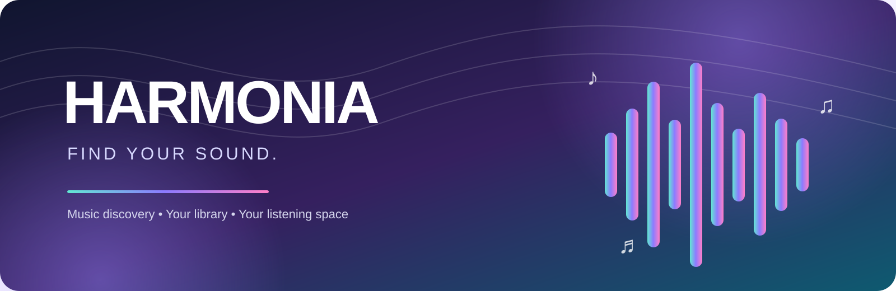

# Harmonia

<p align="center">
  
</p>

<p align="center">
  <a href="https://github.com/kugisakinobaramio-star/Harmonia/actions"></a>
  <a href="https://react.dev/"></a>
  <a href="https://www.typescriptlang.org/"></a>
  <a href="https://developers.cloudflare.com/workers/"></a>
  <a href="https://capacitorjs.com/"></a>
</p>

<p align="center">
  <strong>🎧 Discover. Listen. Make it yours.</strong>
</p>

**A personal music-discovery and listening space.** ✨

Harmonia combines a React interface, a small Express API and a Cloudflare Worker deployment. It is designed around listener-controlled preferences, a local music library, resilient provider fallbacks and a lightweight mobile-friendly experience.

> **Provider reality check:** music catalogues and playback rights differ. Some services provide full streams, while others provide metadata, previews or an embedded player only. A successful search does not guarantee that a full track can be played.

**🌐 Live app:** https://harmonia.kugisakinobaramio.workers.dev  
**💻 Source:** https://github.com/kugisakinobaramio-star/Harmonia  
**📱 Android build:** [Latest debug APK workflow artifact](https://github.com/kugisakinobaramio-star/Harmonia/actions/workflows/android.yml) *(testing build; temporary artifact)*

---


### 🌍 Federated open-audio provider

Harmonia can also resolve public, playable recordings from **Funkwhale** (an open-source, federated music platform). The resolver queries public Funkwhale pods, checks playability, duration, title and artist similarity, and rejects remix/cover-style matches before adding a stream candidate. Pod availability and catalog coverage vary; this source is best treated as an independent-music discovery fallback, not a replacement for commercial catalogues.

Existing open/independent sources include Audius, Jamendo and license-filtered Internet Archive recordings. Each source is best-effort and only returns audio that its upstream makes publicly playable. Harmonia does not use remix-only catalogs as a substitute for original recordings, and provider metadata is never treated as proof that a commercial recording is licensed for redistribution.

## 🎶 What Harmonia includes

- Music search and discovery across supported catalogues
- Native audio playback from verified provider stream/preview URLs; YouTube videos remain in a user-initiated official embedded viewer
- Retry and alternate-source handling when a stream fails
- Listener-specific recommendations based on likes, recent listening, artist affinity, language and genre signals
- Saved likes, playlists, preferences and listening history in browser storage
- Lyrics, artwork, queue controls, playback quality selection and an equalizer interface
- Responsive React UI
- Express API routes running inside a Cloudflare Worker

## 🧠 Personalised discovery

Recommendations should reflect the listener, not a preset artist list.

Harmonia starts with an empty taste profile unless the listener has saved preferences. Signals are built from:
- Tracks the listener plays and replays
- Liked tracks
- Explicitly selected artists, languages and moods
- Artist, language and genre affinity
- Recent listening, with a small novelty preference to avoid repeating the same tracks

The **Made For You** shelf is built from that profile. A separate rotating discovery shelf can introduce tracks from the regional catalogue without pretending those tracks are personal recommendations. If the remote catalogue is unavailable and there is no personal listening history, the recommendation shelf stays empty rather than filling itself with fixed demo artists.

Taste signals are stored in the current browser. They are not uploaded to a shared server-side JSON file.

## 🎼 Music providers

Harmonia uses multiple independent providers because no single catalogue offers every track or stable playback everywhere.

| Provider | Current role | Important limitation |
| --- | --- | --- |
| Audius / Open Audio Protocol | Search and full-track stream candidates | Open catalogue; availability and rights depend on each upload. Uses the canonical Audius API with a discovery-provider fallback. |
| Internet Archive | Fallback for openly licensed audio | Used only when no full stream has been found. Harmonia filters to CC0, CC BY and CC BY-SA item licences and checks title, creator and available runtime metadata. The archive is not a substitute for commercial music catalogues. |
| JioSaavn community API | Search metadata and candidate audio URLs | Third-party integration, not an official JioSaavn developer API. It can change or become unavailable. |
| Jamendo | Candidate audio from its catalogue | API access is free for non-commercial use under the published terms; each recording has its own Creative Commons licence. Commercial use requires a separate agreement, and API access does not guarantee uptime. |
| Deezer | Search metadata and short previews | Preview access is not full-track streaming access. |
| Apple iTunes Search | Search metadata and short previews | Preview URLs are not full-length tracks. |
| YouTube | User-initiated official embedded video player | Playback is subject to YouTube availability, embed permissions and regional restrictions. It is not used as a hidden music-audio fallback; Harmonia does not extract or bypass protected streams. |
| Spotify | Public playlist discovery metadata | Playlist metadata is not a Spotify playback entitlement. Playback uses a separately available source. |

### Open ecosystem direction

Audius is the active open music-network integration. Its read-only API supports public track search and streaming; an API key can be used for higher rate limits. See the [Audius API reference](https://docs.audius.co/api/).

Other open projects are useful for different jobs, but they are not interchangeable streaming catalogues:

- [Internet Archive](https://archive.org/developers/) provides an open collection of media. Harmonia uses it only as a best-effort fallback for recordings with an explicit CC0, CC BY or CC BY-SA licence.
- [Funkwhale](https://docs.funkwhale.audio/) is an open-source, federated, self-hosted audio platform. Connecting a pod requires a configured instance and its access rules; it is not a universal public catalogue.
- [ListenBrainz](https://listenbrainz.org/) provides open listening-history and recommendation services. It is a recommendation/data source, not a source of audio streams. Its [recommendation API](https://listenbrainz.readthedocs.io/en/latest/users/api/recommendation.html) can be explored as an optional, user-authorised integration.
- [MusicBrainz](https://musicbrainz.org/doc/MusicBrainz_API) provides open music metadata, not audio hosting or playback.

Provider integrations should be added only when their API, licensing, authentication and playback behaviour can be verified. Do not scrape protected services, bypass DRM, or label a preview as a full-length stream.

## 🧰 Tech stack

- React 19 and TypeScript
- Vite
- Express 4
- Tailwind CSS
- Cloudflare Workers and Workers Static Assets
- Wrangler
- Node.js 22+ for local development

## 📱 Android app (testing build)

Harmonia now has a Capacitor-based Android packaging path. The first automated **debug-signed APK** was built successfully by GitHub Actions.

<details>
<summary><strong>Get the current testing APK</strong></summary>

1. Open the [Android APK workflow run](https://github.com/kugisakinobaramio-star/Harmonia/actions/runs/43725868017).
2. Scroll to **Artifacts** and download `harmonia-android-debug`.
3. Extract the ZIP and locate `app-debug.apk`.
4. Transfer the APK to your Android phone and open it.
5. If Android asks, allow the file manager or browser you used to install this app, then continue with installation.

The workflow artifact is temporary and expires after 30 days. It is a **debug/testing build**, not a Play Store release. It uses the standard debug signing key, so a future APK signed with a different release key may not install as an in-place update; back up any local-only data before changing builds.

</details>

### What has been verified

- [x] Unit tests passed in the Android workflow
- [x] TypeScript type-check passed
- [x] Vite production build passed
- [x] Capacitor Android project generation and sync passed
- [x] Gradle produced an installable debug APK
- [x] APK artifact upload completed
- [ ] Install and regression-test on a physical Android device
- [ ] Confirm playback, background audio, lock-screen controls, artwork, and local imports on the target phone
- [ ] Configure a protected release-signing key and publish a durable signed release

**Device-testing status:** the APK is built and ready for device testing; successful installation or playback on a Redmi Y3 has not yet been confirmed.

### Build it yourself

The repository's Android workflow regenerates the native project during CI:

```bash
npm install
npm run build
npx cap add android
npx cap sync android
cd android
./gradlew assembleDebug
```

For an existing generated Android project, use:

```bash
npm run android:sync
npm run android:open
```

The packaged app uses `VITE_API_BASE_URL` to reach the deployed Worker. Browser builds keep same-origin API requests when this variable is unset.

## 🛠️ Run locally

### Requirements

- Node.js 22 or newer
- npm

### Install and start

```bash
npm install
npm run dev
```

The development command starts the local Express server with Vite middleware. Open the local address printed in the terminal.

### Validate changes

```bash
npm test
npm run lint
npm run build
```

Before proposing a change, run all three checks. For Worker-specific changes, also run:

```bash
npm run cf:dry-run
npm run dev:cloudflare
```

## ☁️ Deploy to Cloudflare Workers

Harmonia runs as one full-stack Cloudflare Worker:
- Express handles the existing `/api/*` routes.
- Workers Static Assets serves the Vite build.
- The Worker uses the Node.js compatibility runtime and Cloudflare's Node HTTP server adapter.

### Local Worker preview

```bash
npm run dev:cloudflare
```

### Deploy

```bash
npm run deploy:cloudflare
```

The repository's current deployment target is Cloudflare Workers. The configuration is intended to work within the Workers Free plan and does not require paid databases, AI services or storage bindings. Free-plan limits and product terms can change; check the Cloudflare dashboard before increasing usage.

GitHub Pages is not the full-stack deployment target: it cannot run the Express API routes in `server.ts`.

## 🔐 Environment configuration

Copy `.env.example` to `.env` only when you need a listed integration.

- Keep credentials out of source control.
- Put production secrets in the hosting provider's secret manager.
- Never expose private provider tokens in browser-side code.
- Do not commit local `.env` files or deployment credentials.

## 🛡️ Privacy and data storage

- Likes, playlists, preferences, recent listening and taste signals are stored in browser `localStorage`.
- The current backend does not provide authenticated multi-device user sync.
- User data is intentionally not stored in a shared server-side JSON file.
- Clearing browser site data removes the local library and taste profile.
- Multi-device sync should be introduced only with real authentication and per-account storage.

## 🌐 Network and API safety

The media proxy is designed to:
- Accept HTTPS destinations only
- Reject local and non-public IP destinations
- Resolve and validate DNS addresses
- Revalidate redirect destinations
- Apply response-size limits
- Restrict artwork responses to supported raster formats
- Use bounded in-memory caches and per-client throttling

Cloudflare Workers does not implement Node's `dns.lookup()`. The Worker adapter uses the supported `dns.resolve4()` and `dns.resolve6()` APIs over DNS-over-HTTPS; local Node development uses `dns.lookup()`.

## 🧩 Troubleshooting

**A track appears in search but will not play**
- Search results, previews and full streams are different things.
- Some providers expose only short previews.
- A YouTube video may be unavailable for embedding or in a particular region.
- Try another result only after confirming it is the same recording; do not weaken title, artist or duration matching to force a result.

**Playback stops at 0:00**
- Check whether the provider URL is still valid and whether the audio endpoint is reachable.
- Check Worker logs for the safe `[music-resolve-diagnostics]` event.
- Do not share signed stream URLs or private tokens in bug reports. Share only the diagnostic counts, provider status and playback error code.

**The app loads but API requests fail**
- Confirm that the Worker deployment completed and is receiving traffic.
- Check the Cloudflare Worker logs.
- Test the local API with `npm run dev` to distinguish a Worker-specific issue from an application issue.

**Recommendations look empty**
- Play or like a few tracks, or choose artists/languages in Personalise.
- Recommendations are intentionally not populated with a fixed artist list.
- Regional discovery may be empty when its upstream catalogue is unavailable.

## 🤝 Contributing

1. Create a focused branch from `main`.
2. Make one coherent change at a time.
3. Add or update regression tests for bug fixes.
4. Run `npm test`, `npm run lint`, `npm run build` and the Worker dry-run when relevant.
5. Open a pull request with the observed problem, root cause, changes and test results.

Avoid broad dependency changes and unverified provider additions. Prefer small adapters with explicit timeouts, strict metadata matching, clear licensing boundaries and safe failure behaviour.

## 🚧 Project status

Harmonia is an evolving personal project. External provider APIs, regional availability, preview policies and hosting quotas can change independently of the code. Passing CI confirms the repository builds and its automated checks pass; it does not prove that every third-party track is playable in every region or browser. The Android debug APK is available for manual device testing; a production release and device-tested status are still pending.
