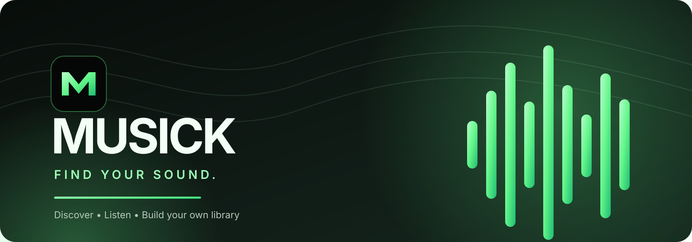

# MusicKK

<p align="center">
  
</p>

<p align="center">
  <a href="https://github.com/kugisakinobaramio-star/Musick/actions"></a>
  <a href="https://react.dev/"></a>
  <a href="https://www.typescriptlang.org/"></a>
  <a href="https://developers.cloudflare.com/workers/"></a>
  <a href="https://capacitorjs.com/"></a>
</p>

<p align="center"><strong>Discover. Listen. Make it yours.</strong></p>

MusicKK is a listener-focused music discovery and playback application for the web and Android. It brings together music search, playable-source resolution, personalised discovery, playlists, a local library and optional account-based cloud sync.

- **Live web app:** https://harmonia.kugisakinobaramio.workers.dev
- **GitHub repository:** https://github.com/kugisakinobaramio-star/Musick
- **Android releases:** https://github.com/kugisakinobaramio-star/Musick/releases
- **Latest published Android release:** [v1.1.1](https://github.com/kugisakinobaramio-star/Musick/releases/tag/android-v1.1.1)

> **Playback and catalogue note:** Provider catalogues, regional availability and playback rights differ. A search result may contain metadata or a short preview rather than a full playable recording. MusicKK should only present a source as playable when the provider supplies a usable playback route.

## What MusicKK offers

- Music search and discovery across supported catalogue providers.
- Playback from available provider stream or preview URLs.
- An official, user-initiated YouTube embedded player where supported.
- Queue controls, artwork, lyrics when available, playback quality options and an equalizer interface.
- Likes, playlists, listening history and personal preferences.
- Personalised recommendations informed by listening behaviour and selected preferences.
- Responsive layouts designed for mobile and desktop.
- An Android application built with Capacitor.

## Personalised music discovery

MusicKK's recommendation engine uses available listening and catalogue metadata to estimate musical preferences. Signals can include:

- Likes and recent listening activity.
- Artist, genre, language and mood preferences.
- Track metadata such as mood, energy and BPM when available.
- Repetition controls and artist diversity.

Language is one signal, not a substitute for musical similarity. Recommendations are constrained by playback eligibility: a metadata-only result should not be presented as a playable track.

The current recommendation system is primarily local and metadata-driven. It is not an audio-understanding model and should not claim to infer musical similarity from the sound of a recording unless audio features are actually available.

## Music sources

MusicKK uses independent providers because no single catalogue offers every recording or stable playback in every region.

| Provider | Role | Limitations |
| --- | --- | --- |
| Audius / Open Audio Protocol | Search and candidate audio streams | Open catalogue; availability and rights depend on each upload. |
| Funkwhale | Federated public-audio discovery fallback | Pod availability, access rules and catalogue coverage vary. |
| Jamendo | Catalogue search and candidate audio | Recording licences and API terms apply; commercial use may require a separate agreement. |
| Internet Archive | Fallback for openly licensed recordings | MusicKK filters for supported Creative Commons licence types where licence metadata is available. |
| JioSaavn community API | Search metadata and candidate audio URLs | Third-party integration, not an official JioSaavn developer API; it may change or become unavailable. |
| Deezer | Search metadata and short previews | Preview access is not full-track streaming access. |
| Apple iTunes Search | Search metadata and short previews | Preview URLs are not full-length tracks. |
| YouTube | Official embedded video playback | Subject to embed permissions, regional restrictions and YouTube availability. MusicKK does not extract protected streams or bypass DRM. |
| Spotify | Public playlist discovery metadata | Playlist metadata does not grant Spotify playback rights. |

Provider integrations are best-effort. MusicKK must not scrape protected services, bypass DRM, treat a preview as a full track, or imply that provider metadata grants redistribution rights.

Useful provider documentation:
- [Audius API](https://docs.audius.co/api/)
- [Internet Archive developer documentation](https://archive.org/developers/)
- [Funkwhale documentation](https://docs.funkwhale.audio/)
- [MusicBrainz API](https://musicbrainz.org/doc/MusicBrainz_API)
- [ListenBrainz API](https://listenbrainz.readthedocs.io/en/latest/users/api/)

## Accounts, local data and cloud sync

MusicKK is designed to remain usable without requiring an account.

- **Guest mode:** use the app without signing in; local functionality remains available.
- **Optional authentication:** Firebase Authentication supports configured Google and email/password sign-in.
- **Cloud sync:** the Firebase integration is designed to synchronize supported library, playlist, listening and preference data for signed-in users.
- **Offline behaviour:** local data remains important when the network is unavailable; queued synchronization can retry later.
- **Migration safety:** account migration should preview differences and create a local backup before applying a merge.

Cloud sync depends on the Firebase project, authentication providers, Android OAuth configuration and Firestore security rules being correctly configured. Do not assume that a successful application build means production Firebase configuration or deployed security rules have been verified.

The app must never sync temporary stream URLs, provider credentials or private tokens as library metadata. Do not put service-account credentials or private API keys in the client application.

## Technology

- React 19 and TypeScript
- Vite
- Express 4
- Tailwind CSS
- Firebase Authentication and Cloud Firestore
- Capacitor 8 for Android
- Cloudflare Workers and Workers Static Assets
- Wrangler
- Node.js 22 or newer

The application uses an Express API layer with a Cloudflare Workers deployment adapter. Workers Static Assets serves the Vite-built frontend.

## Android application

| Setting | Value |
| --- | --- |
| App name | MusicKK |
| Android application ID | `com.harmonia.music` |
| Native framework | Capacitor 8 |
| Web build directory | `dist` |

The application ID is part of the Android app identity. Keep `com.harmonia.music` unchanged so existing installations can receive compatible updates signed with the same release key.

### Published releases

Stable signed APKs are published through GitHub Releases when a version-tag workflow completes successfully.

- [Download the latest published APK](https://github.com/kugisakinobaramio-star/Musick/releases/latest)
- [View all releases](https://github.com/kugisakinobaramio-star/Musick/releases)

A CI debug APK is a test artifact, not a stable signed release. Automated builds also do not prove playback, background behaviour or authentication on a physical Android device.

### Release signing

Release signing is handled by GitHub Actions. The repository workflow expects these Actions secrets to be configured by the repository owner:

- `ANDROID_KEYSTORE_BASE64`
- `ANDROID_KEYSTORE_PASSWORD`
- `ANDROID_KEY_ALIAS`
- `ANDROID_KEY_PASSWORD`

Never commit a keystore, signing password, base64 keystore value or other credential. Keep a secure backup of the original release keystore. Future updates must use the same signing identity to install over an existing release.

Stable release tags use this format:

```text
android-vMAJOR.MINOR.PATCH
```

For example:

```bash
git tag android-v1.2.0
git push origin android-v1.2.0
```

Only create a release tag after reviewing the changes and confirming that the release workflow is ready.

## Getting started

### Requirements

- Node.js 22 or newer
- npm

### Install dependencies

```bash
npm install
```

### Start local development

```bash
npm run dev
```

The development server starts the local Express server with Vite middleware. Open the local URL printed in the terminal.

### Run checks

```bash
npm test
npm run lint
npm run build
```

- `npm test` runs the automated Node test suites.
- `npm run lint` runs the TypeScript compiler check (`tsc --noEmit`).
- `npm run build` creates the production web build.

For Worker-specific changes, also run:

```bash
npm run cf:dry-run
npm run dev:cloudflare
```

### Android development

```bash
npm run android:sync
npm run android:open
```

These commands build the web app, synchronize the Capacitor Android project and open it in Android Studio when the required Android tooling is installed.

## Deploying to Cloudflare Workers

The configured deployment target is Cloudflare Workers.

### Local Worker preview

```bash
npm run dev:cloudflare
```

### Dry-run deployment

```bash
npm run cf:dry-run
```

### Deploy

```bash
npm run deploy:cloudflare
```

Deployment requires the appropriate Cloudflare account access and configuration. Review the Cloudflare dashboard for current plan limits and usage. GitHub Pages cannot host the full application by itself because it cannot run the Express API routes in `server.ts`.

## Environment variables and secrets

Use `.env.example` as the reference for supported local configuration.

- Keep local `.env` files out of source control.
- Store production secrets in the hosting provider's secret manager.
- Never expose private provider tokens in browser-side code.
- Never commit Firebase service-account files, OAuth client secrets, signing keys or passwords.
- Public Firebase web configuration is not a substitute for Firestore security rules.

## Privacy and network safety

MusicKK should keep user data scoped to the appropriate local guest profile or authenticated account.

- Do not store user libraries in a shared server-side JSON file.
- Keep temporary playback URLs and private provider credentials out of cloud library documents.
- Account switching must not expose one user's cached library to another account.
- Preserve local data and provide a backup/preview before migrations or destructive operations.

The media proxy is designed with safeguards such as HTTPS-only destinations, rejection of local or non-public IP addresses, redirect validation, response-size limits, supported artwork content types, bounded caches and per-client throttling.

Cloudflare Workers does not implement Node's `dns.lookup()`. The Worker adapter uses supported DNS-over-HTTPS resolution APIs; local Node development uses Node's DNS implementation.

## Troubleshooting

**A track appears in search but will not play**
- Search metadata, previews and full streams are different things.
- The provider may expose only a short preview.
- YouTube embedding may be unavailable for a video or region.
- Try another result only after confirming it is the same recording.

**Playback stalls or remains at 0:00**
- Check whether the provider URL is still valid and whether the audio endpoint is reachable.
- Check application and Worker logs for the relevant provider and playback error.
- Do not include signed stream URLs, access tokens or private credentials in bug reports.

**The app loads but API requests fail**
- Confirm that the Worker deployment completed and is receiving traffic.
- Check Cloudflare Worker logs.
- Run `npm run dev` locally to help distinguish a Worker-specific problem from an application problem.

**Cloud sync is unavailable**
- Check network connectivity and Firebase Authentication state.
- Confirm the intended Firebase project and Firestore database are configured.
- Check that the correct authentication providers and authorized domains are enabled.
- Confirm that the Firestore rules have been reviewed and deployed intentionally.
- Do not disable security rules to work around a permission error.

**Recommendations are empty or repetitive**
- Play or like tracks, or select preferences in Personalise.
- Recommendations depend on available listening history and catalogue metadata.
- A provider outage or a lack of eligible playable tracks can reduce discovery results.

## Contributing

1. Start from the latest `main` branch.
2. Create a focused feature branch; do not commit directly to `main`.
3. Make one coherent change at a time.
4. Add regression tests for bug fixes.
5. Run `npm test`, `npm run lint` and `npm run build`; run Worker and Android checks when relevant.
6. Open a pull request describing the observed issue, root cause, implementation and actual test results.

Do not make broad dependency changes or add unverified providers without explaining the trade-offs. Prefer small, testable changes with explicit timeouts, strict metadata matching and safe failure behaviour.

## Project status and limitations

MusicKK is an evolving project. External provider APIs, regional catalogues, preview policies, licensing terms and hosting quotas can change independently of the application.

Passing CI means that the configured automated checks passed; it does not prove that every provider works in every region, that every track is playable, or that background playback and authentication have been verified on every physical Android device. Report manual testing separately from automated test results.
