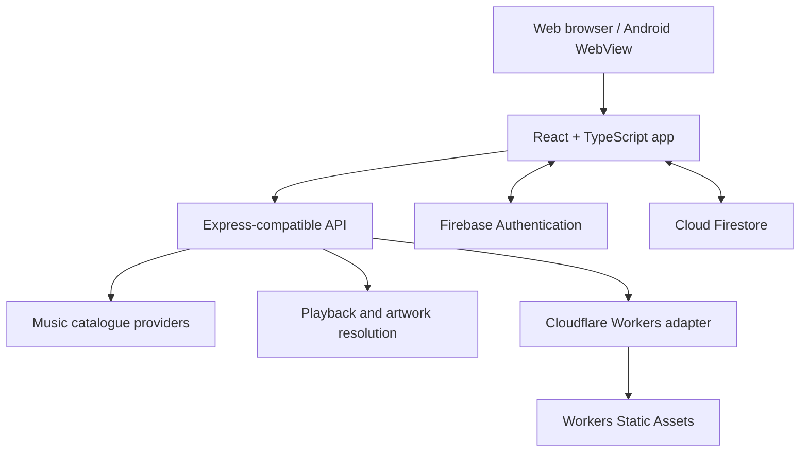

# MusicKK

<p align="center">
  
</p>

<p align="center">
  <a href="https://github.com/kugisakinobaramio-star/Musick/actions"></a>
  <a href="https://react.dev/"></a>
  <a href="https://www.typescriptlang.org/"></a>
  <a href="https://capacitorjs.com/"></a>
  <a href="https://developers.cloudflare.com/workers/"></a>
</p>

<p align="center"><strong>Discover. Listen. Make it yours.</strong></p>

**MusicKK** is a music discovery and listening application for the web and Android. It combines catalogue search, available playback sources, personalised discovery, playlists, a local library and optional Firebase-backed account sync.

| | |
|---|---|
| **Web app** | [harmonia.kugisakinobaramio.workers.dev](https://harmonia.kugisakinobaramio.workers.dev) |
| **Source code** | [GitHub repository](https://github.com/kugisakinobaramio-star/Musick) |
| **Android APKs** | [GitHub Releases](https://github.com/kugisakinobaramio-star/Musick/releases) |
| **Latest published Android release** | [v1.1.1](https://github.com/kugisakinobaramio-star/Musick/releases/tag/android-v1.1.1) |
| **Android application ID** | `com.harmonia.music` |

> **Playback matters:** Search metadata, a short preview and a full playable recording are three different things. Availability depends on the provider, region, licence and embed permissions. MusicKK should only label a track as playable when a usable playback source is actually available.

## Contents

- [Highlights](#highlights)
- [How the app is structured](#how-the-app-is-structured)
- [Discovery and recommendations](#discovery-and-recommendations)
- [Music providers](#music-providers)
- [Accounts, privacy and sync](#accounts-privacy-and-sync)
- [Technology](#technology)
- [Run locally](#run-locally)
- [Android development and releases](#android-development-and-releases)
- [Cloudflare deployment](#cloudflare-deployment)
- [Configuration and secrets](#configuration-and-secrets)
- [Troubleshooting](#troubleshooting)
- [Contributing](#contributing)
- [Known limitations](#known-limitations)

## Highlights

- **Search and discovery:** Search music and browse supported catalogue providers.
- **Playback:** Use available provider streams, previews or supported YouTube embeds. The type of playback available depends on the source.
- **Player:** Queue controls, artwork, lyrics when available, playback options and an equalizer interface.
- **Your library:** Likes, playlists, listening history and personal preferences.
- **Personalisation:** Recommendations use listening behaviour and available track metadata.
- **Mobile experience:** Responsive web UI and an Android app built with Capacitor.
- **Optional accounts:** Firebase sign-in and cloud sync are available without making login a requirement for guest use.

## How the app is structured

MusicKK is a React application backed by an Express-compatible API. The same API is adapted for local Node.js development and Cloudflare Workers deployment.



**Important boundaries**
- The client handles the interface, local library experience, playback UI and Firebase client integration.
- The API layer coordinates supported catalogue and media-related requests.
- Cloudflare Workers hosts the production API adapter and built static assets.
- Firebase is a separate optional account and sync service; it is not the music-streaming provider.

## Discovery and recommendations

The recommendation engine uses the signals available to the app, which can include:

- Likes and recent listening activity.
- Artist, genre, language and mood preferences.
- Track metadata such as mood, energy and BPM, when supplied.
- Repetition controls and artist-diversity preferences.

Language is one preference signal; it should not be treated as musical similarity. Results should be filtered for relevance and playback eligibility, and metadata-only entries should not be presented as playable tracks.

The current recommendation approach is primarily local and metadata-driven. It is **not** a trained audio-understanding model and cannot reliably judge the sound of a recording from its title or artist metadata alone.

## Music providers

MusicKK uses multiple sources because catalogue coverage, playback rights and regional availability vary.

| Provider | How it is used | Important limitation |
|---|---|---|
| Audius / Open Audio Protocol | Catalogue search and candidate audio streams | Availability and rights depend on each upload. |
| Funkwhale | Federated public-audio discovery fallback | Pod availability, access rules and catalogue coverage vary. |
| Jamendo | Catalogue search and candidate audio | Licence terms apply; some uses may require a separate commercial agreement. |
| Internet Archive | Discovery of recordings with licence metadata | Availability and licence metadata vary by item. |
| JioSaavn community API | Search metadata and candidate audio URLs | Third-party integration, not an official JioSaavn developer API; it may change or become unavailable. |
| Deezer | Search metadata and short previews | A preview is not full-track streaming access. |
| Apple iTunes Search | Search metadata and short previews | Preview URLs are not full-length tracks. |
| YouTube | Embedded video playback | Subject to embed permissions, regional restrictions and YouTube availability. |
| Spotify | Public playlist discovery metadata | Playlist metadata does not grant Spotify playback rights. |

Provider integrations are best-effort. MusicKK must not bypass DRM, extract protected streams, or imply that catalogue metadata grants redistribution rights. A provider may change its API or stop serving a source without notice.

Provider documentation:
- [Audius API](https://docs.audius.co/api/)
- [Funkwhale documentation](https://docs.funkwhale.audio/)
- [Internet Archive developer documentation](https://archive.org/developers/)
- [MusicBrainz API](https://musicbrainz.org/doc/MusicBrainz_API)
- [ListenBrainz API](https://listenbrainz.readthedocs.io/en/latest/users/api/)

A machine-readable inventory of every provider (and what it contributes) lives in `src/server/providers/types.ts`.

## Accounts, privacy and sync

MusicKK is intended to remain usable without requiring an account.

- **Guest mode:** Use the app without signing in. Local functionality remains available.
- **Optional authentication:** Firebase Authentication supports configured Google and email/password sign-in.
- **Cloud sync:** The Firebase integration is designed to sync supported library, playlist, listening and preference data for signed-in users.
- **Offline use:** Local data remains important when the network is unavailable; queued sync work can retry later.
- **Migration safety:** Account migration should preview differences and create a local backup before applying a merge.

**Full setup and troubleshooting:** see **[docs/firebase.md](docs/firebase.md)** (web + Android + security rules + sync behaviour) and the short Android checklist in **[docs/firebase-android-setup.md](docs/firebase-android-setup.md)**.

Cloud sync depends on correct Firebase project configuration, enabled sign-in providers, Android OAuth setup and reviewed Firestore security rules. A successful application build does not prove that production authentication, cloud sync or deployed security rules are working.

Private provider credentials, service-account keys and temporary playback URLs must not be placed in client code or synchronized as ordinary library metadata. Never commit secrets to the repository. Security invariants and the required denials are documented in `security_spec.md`.

## Technology

| Area | Technology |
|---|---|
| UI | React 19, TypeScript, Tailwind CSS |
| Build | Vite |
| API | Express 4 |
| Android | Capacitor 8 |
| Accounts and cloud data | Firebase Authentication, Cloud Firestore |
| Production hosting | Cloudflare Workers and Workers Static Assets |
| Local runtime | Node.js 22+ |
| Package manager | npm |

## Run locally

### Requirements

- Node.js 22 or newer
- npm

### Install and start

```bash
npm install
npm run dev
```

The local command starts the Express application with Vite middleware. Open the local address printed in the terminal.

### Quality checks

```bash
npm test
npm run lint
npm run build
```

| Command | What it checks |
|---|---|
| `npm test` | Automated Node test suites |
| `npm run lint` | TypeScript compiler check (`tsc --noEmit`) |
| `npm run build` | Production Vite build |

For Cloudflare-specific changes, also run:

```bash
npm run cf:dry-run
npm run dev:cloudflare
```

## Android development and releases

| Setting | Value |
|---|---|
| App name | MusicKK |
| Application ID | `com.harmonia.music` |
| Native framework | Capacitor 8 |
| Web build directory | `dist` |

Keep the application ID unchanged. Updating an existing Android installation also requires the same signing identity used for the installed release.

### Build and open Android project

```bash
npm run android:sync
npm run android:open
```

These commands build the web app, synchronize the Capacitor Android project and open it in Android Studio when the Android tooling is installed.

### Download releases

- [Latest published APK](https://github.com/kugisakinobaramio-star/Musick/releases/latest)
- [All published releases](https://github.com/kugisakinobaramio-star/Musick/releases)

The Android GitHub Actions workflow builds a debug APK for branch and pull-request checks. A version tag matching `android-vMAJOR.MINOR.PATCH` is the workflow path for a signed stable APK and GitHub Release.

Release signing requires these repository Actions secrets:

- `ANDROID_KEYSTORE_BASE64`
- `ANDROID_KEYSTORE_PASSWORD`
- `ANDROID_KEY_ALIAS`
- `ANDROID_KEY_PASSWORD`

Never commit the keystore or any signing secret. Keep a secure backup of the release keystore; without the same signing identity, an existing installation cannot receive a normal in-place update.

A CI debug APK is a test artifact, not a published stable release. Automated Android builds do not replace testing playback, background behaviour, authentication and notification controls on physical devices.

## Cloudflare deployment

The repository's Worker configuration is in `wrangler.jsonc`. It points Wrangler to `worker/index.ts` and serves the built `dist` directory as Workers Static Assets, with API requests routed through the Worker.

### Local Worker preview

```bash
npm run dev:cloudflare
```

### Dry-run

```bash
npm run cf:dry-run
```

### Deploy

```bash
npm run deploy:cloudflare
```

Deployment requires access to the configured Cloudflare account. Check the Cloudflare dashboard for current usage, plan limits and deployment status. GitHub Pages can serve static frontend files, but it cannot run the Express API routes in `server.ts`.

## Configuration and secrets

Use `.env.example` as a starting reference for local configuration. Hosting environments may inject their own runtime variables.

- Keep local `.env` files out of source control.
- Store production secrets in the hosting provider's secret manager.
- Never expose private provider tokens in browser-side code.
- Never commit Firebase service-account files, OAuth client secrets, Android signing keys or passwords.
- Public Firebase web configuration is not a replacement for restrictive Firestore security rules.

See also [docs/firebase.md](docs/firebase.md) for Firebase-specific configuration and the Android `google-services.json` requirements.

## Troubleshooting

<details>
<summary><strong>A search result appears but will not play</strong></summary>

Search metadata, short previews and full streams are different things. The provider may expose only a preview, or the source may be unavailable in your region. YouTube embedding can also be disabled for a particular video. Check the source type and provider response before treating this as a player defect.
</details>

<details>
<summary><strong>Playback stalls or remains at 0:00</strong></summary>

Check whether the provider URL is still valid and whether the audio endpoint is reachable. Review the app and Worker logs for the provider and playback error. Do not include signed stream URLs, access tokens or private credentials in bug reports.
</details>

<details>
<summary><strong>The app loads but API requests fail</strong></summary>

Confirm that the Worker deployment completed and is receiving traffic. Check Cloudflare Worker logs. Run `npm run dev` locally to help distinguish a Worker-specific problem from a deployment problem.
</details>

<details>
<summary><strong>Cloud sync is unavailable</strong></summary>

Check network connectivity and Firebase Authentication state. Confirm the intended Firebase project and Firestore database, enabled sign-in providers, authorized domains and Android OAuth configuration. Verify that the Firestore rules were reviewed and intentionally deployed. Do not disable security rules to work around a permission error.

Full guide: [docs/firebase.md](docs/firebase.md).
</details>

<details>
<summary><strong>Recommendations are empty or repetitive</strong></summary>

Recommendations depend on listening history, selected preferences and available catalogue metadata. A provider outage or a shortage of relevant playable tracks can reduce discovery results.
</details>

## Contributing

Contributions should be focused, reviewable and safe for existing users.

1. Start from the latest `main`.
2. Create a feature branch; do not commit directly to `main`.
3. Make one coherent change per pull request where practical.
4. Add regression tests for bug fixes.
5. Run `npm test`, `npm run lint` and `npm run build`; run Worker and Android checks when relevant.
6. Describe the observed problem, root cause, files changed, test results and any remaining risks in the pull request.

### Rules for AI coding agents

AI coding agents working on this repository must follow the same review process:

- Inspect the existing architecture before editing; do not recreate the app from scratch.
- Work on a separate branch and open a pull request.
- Preserve `com.harmonia.music`, existing features and user data.
- Do not silently delete, overwrite or migrate user data.
- Do not change `server.ts`, production backend behaviour, Firebase rules or deployment configuration without explicit approval.
- Do not add paid services, API dependencies or secrets without approval.
- Report tests honestly; never claim physical-device verification when only a build was run.
- Do not merge or deploy without human approval.

## Known limitations

MusicKK is an evolving project. External provider APIs, regional catalogues, preview policies, licensing terms and hosting quotas can change independently of the application.

Passing CI means the configured automated checks passed. It does not prove that every provider works in every region, every search result is playable, or background playback and authentication have been verified on every physical Android device. Automated checks and manual device testing should always be reported separately.
